# Neraca Lab - Database Schema (v1)

PostgreSQL 15+ with the **pgvector** extension (runs on `postgres:17-alpine` + pgvector 0.8.7, built from
`backend/postgres/Dockerfile`, in Docker, database `neracalab`).

All tables and views live in the **`public`** schema. Objects are referenced without a schema
prefix (`company`, `income_statement`, ...), so any table can reference any other with a plain
foreign key.

| Script (`backend/src/main/resources/db/`) | Content                                                                          |
|-------------------------------------------|----------------------------------------------------------------------------------|
| `V1.0.1__schema.sql`                      | core tables: company, reporting periods, statements, corporate actions           |
| `V1.0.2__schema_market_valuation.sql`     | segments, daily prices, share counts, market / valuation snapshots, metrics      |
| `V1.0.3__views.sql`                       | 4 analysis views (dropped and recreated every start)                             |
| `V1.0.7__schema_ingestion.sql`            | ingestion bookkeeping: uploaded workbooks, job progress (section 4.8)            |
| `V1.0.8__schema_auth.sql`                 | users, roles, role permissions, user roles, login sessions (section 4.9)         |
| `V1.0.9__schema_ingestion_created_by.sql` | who started an ingestion job (`ingestion_job.created_by`), `app_migration` (section 4.8) |
| `V1.0.10__schema_screening.sql`           | AI stock screening: universe, daily snapshot, news cache, runs, candidates, agent scores, lessons, LLM usage (section 4.11) |
| `V1.0.11__schema_fx.sql`                  | `fx_rate_daily`: ECB reference rates that convert listings quoted in another currency (section 4.10) |
| `V1.0.14__schema_rag.sql`                 | RAG vector store: `vector` extension, `rag_document`, `rag_chunk`; job types `RAG_PDF`, `RAG_NEWS` (section 4.12) |
| `V1.0.15__schema_analysis.sql`            | AI analysis of one stock: `analysis_run`, `analysis_agent_score`, `llm_usage.analysis_id` (section 4.13) |
| `V1.0.16__schema_syirkah.sql`             | `balance_sheet.temporary_syirkah_funds`: banks' sharia depositor funds, neither liabilities nor equity (section 3) |
| `V1.0.17__schema_screening_selection.sql` | `screening_run.tickers`: screening of selected stocks; `market_cap_tier` NULL for those runs (section 4.11) |
| `V1.0.18__schema_ingestion_error.sql`     | `ingestion_error`: error log of the .xlsx ingestion API, work list of Claude Code (`fixed_by_claude_code`); [AI_INGESTION_DOCS.md](AI_INGESTION_DOCS.md) section 6 |
| `V1.0.19__schema_ingestion_cost.sql`      | `llm_usage.job_id`: the model calls of a financial statement upload (tokens and cost per job); [AI_INGESTION_DOCS.md](AI_INGESTION_DOCS.md) section 7 |
| `V1.0.20__schema_screening_currency.sql`  | `fundamental_snapshot.financial_currency`: currency of a listing's Yahoo fundamentals, for companies that report in another currency than they trade in (section 4.11) |
| `V1.0.23__schema_technical.sql`           | technical analysis ([TECHNICAL_DOCS.md](TECHNICAL_DOCS.md)): `index_daily` (IHSG bars, unique index_code + trading_date), `corporate_event` (dividends / splits / other dated events for chart markers, unique company + type + date + source), `corporate_event_fetch` (last event fetch per company and source), `macro_series` (BI_RATE, SBN_10Y observations; USD/IDR is read from `fx_rate_daily`), `indicator_snapshot` (latest snapshot per company: `as_of_date`, `schema_version`, `snapshot_json` JSONB, `input_hash`; [../indicator-snapshot.md](../indicator-snapshot.md)), `chart_setting` (a user's chart settings JSONB, deleted with the user). New tables only |
| `V1.0.25__schema_markets_macro.sql`       | Forex / commodity prices and macro data ([PRICE_INGESTION_DOCS.md](PRICE_INGESTION_DOCS.md) section 1b, [MACRO_DOCS.md](MACRO_DOCS.md)): `market_instrument` (the catalog: market FOREX / COMMODITY, source yahoo / worldbank / imf / fred (the check re-created on every start), symbol, quote currency, unit, DAILY / MONTHLY, tick size, `max_spike` of the bad-print cleaning), `instrument_daily` (their bars, unique instrument + trading_date), `macro_series_def` (the macro catalog: source, `source_ref`, unit, frequency, `release_lag_days`, priority, `used_by`, sanity range `min_value` / `max_value`, `max_change`); `macro_series` gains `period_end`, `release_date` (point in time), `revision`, `updated_at`. `ingestion_job.job_type` gains `MACRO` (in V1.0.10 and V1.0.14, which re-create the check) |
| `V1.0.27__schema_macro_analysis.sql`      | AI macro analysis of a country ([MACRO_ANALYSIS_DOCS.md](MACRO_ANALYSIS_DOCS.md)): `macro_analysis_run`, `macro_analysis_agent_score`, `macro_analysis_lesson`, `llm_usage.macro_analysis_id`; `ingestion_job.job_type` gains `MACRO_ANALYSIS` (in V1.0.10 and V1.0.14, which re-create the check) (section 4.14) |
| `V1.0.28__schema_rag_macro.sql`           | macro documents of a country in the RAG vector store ([RAG_DOCS.md](RAG_DOCS.md) section 2a): `rag_document` / `rag_chunk` gain `country` (`company_id` NULL for them; one of the two, check), `rag_document` gains `issuer` and `document_type`; unique per country, type and file (section 4.12) |
| `V1.0.29__schema_registration.sql`        | the type of a company PDF in `rag_document.document_type` (`FINANCIAL_STATEMENT`, set for every company PDF stored before, or `REGISTRATION`; `ck_rag_document_company_type`), `registration_report` and `registration_insider`: the monthly registration reports of securities holders and the directors' and commissioners' shares in them ([REGISTRATION_DOCS.md](REGISTRATION_DOCS.md); section 4.12a) |
| `V1.0.30__schema_technical_screening.sql` | AI technical screening ([TECHNICAL_SCREENING_DOCS.md](TECHNICAL_SCREENING_DOCS.md) section 6): `listing_price_daily` (daily bars of every `stock_listing`, PK listing + trading date), `technical_screening_run` (a tier or tickers, check), `technical_screening_candidate`, `technical_screening_agent_score` (agents GILL, MURPHY, TUDOR_JONES, DRUCKENMILLER), `technical_screening_lesson`, `llm_usage.technical_screening_id`; `ingestion_job.job_type` gains `LISTING_PRICES` and `TECHNICAL_SCREENING` (in V1.0.10 and V1.0.14, which re-create the check) |
| `V1.0.32__schema_registration_holders.sql` | `registration_holder`: the shareholders of 5 % or more of a registration report; `registration_report.holders` and the shares by type of holder (`controller_shares`, `controller_affiliate_shares`, `insider_shares`, `treasury_shares`); NULL / no rows for a report stored before |
| `V1.0.4__data_HRTA_financials.sql`        | HRTA statements and segments from the six IDX filings in `data/IDX_XBRL/HRTA/xlsx`        |
| `V1.0.5__data_HRTA_market.sql`            | HRTA share counts (filings) and daily prices (`data/IDX_XBRL/HRTA/price`)                 |
| `V1.0.12__data_SMDR_shares.sql`           | SMDR share counts from public sources (not derivable from its USD filings) and its 2023 1:5 stock split; no-op until SMDR is uploaded; also run after every upload |
| `V1.0.13__data_BNGA_shares.sql`           | BNGA audited year-end share counts 2021 .. 2025 from its annual reports (not derivable from its filings: two share classes, treasury shares); no-op until BNGA is uploaded; also run after every upload |
| `V1.0.21__data_RAJA_shares.sql`           | RAJA share counts from public sources (not derivable from its USD filings), its 1:5 stock split of 2026-07-16 (after its latest filing, so the published counts did not fit the filed EPS) and the EPS of the earlier periods on the basis after it; no-op until RAJA is uploaded |
| `V1.0.22__data_TUGU_shares.sql`           | TUGU's 1:2 stock split of 2023-05-24 from public sources (the FY2023 filing does not restate its FY2022 comparative, so the split is never detected from the filings), split-adjusted share counts 3,555,575,600 where empty and the per-share figures of the dates before it on the basis after it; no-op until TUGU is uploaded |
| `V1.0.24__data_BACH_shares.sql`           | BACH's share count after its IPO of 2026-07-08 (615,000,000 new shares at Rp 442, after its only filing, H1 2026): 4,084,430,000 from the listing date and the IPO in `corporate_action`; no-op until BACH is uploaded; also run after every upload |
| `V1.0.31__data_BNBR_shares.sql`           | BNBR share counts its filings cannot give (five par-value series) and Yahoo Finance gives wrong: 160,057,457,509 from 2023-12-31, 173,416,832,509 from the PMTHMETD of 2024-12-11, 263,336,671,587 from the PMHMETD V of 2026-07-31; the placement and the rights issue in `corporate_action`. Runs before V1.0.6 and after every upload |
| `V1.0.37__data_RANS_shares.sql`           | RANS share counts its only filing does not give and Yahoo Finance gives wrong: 10,084,250,000 founders' shares at 2025-12-31, 12,609,250,000 from the IPO of 2026-07-10 (2,525,000,000 shares offered) and that corporate action |
| `V1.0.46__schema_rag_xbrl.sql`            | source type `XBRL` in `rag_document`: the uploaded IDX XBRL workbooks in the RAG vector store, document type `FINANCIAL_STATEMENT`, keyed by the file's SHA-256 ([RAG_DOCS.md](RAG_DOCS.md) section 2b); the checks are in V1.0.29 / V1.0.33, which re-create them first on every start; column comments (section 4.12) |
| `V1.0.40__schema_dev_context.sql`         | `dev_context`: the development context of Claude Code - issues, fixes, data gaps, decisions, procedures - with an embedding (`vector(1536)`, HNSW) and a full-text vector; API `/api/v1/dev-context` ([DEV_CONTEXT_DOCS.md](DEV_CONTEXT_DOCS.md)) |
| `V1.0.38__data_ABDA_expenses.sql`         | ABDA FY2021 / FY2022 income statements: the G&A its FY2022 filing tags as interest and finance costs are operating expenses, no interest, operating income = profit before tax (only while the rows hold the tag's figures) |
| `V1.0.39__data_ACRO_AGAR_AISA_shares.sql` | share counts of ACRO (3,469,138,591 from its IPO of 2024-01-11), AGAR (1,000,000,000) and AISA (9,311,800,000), from KSEI's 1% lists and the listing records: their filings give none and no Yahoo Finance count fits |
| `V1.0.41__data_ALKA_AMAN_AREA_ATAP_BATR_shares.sql` | share counts of ALKA (507,665,055), AMAN (3,873,500,000), AREA (2,029,601,000 founders', 2,539,601,000 from its IPO of 2024-04-01), ATAP (1,250,000,000) and BATR (3,025,000,000 from its IPO of 2024-06-10), from KSEI's 1% lists, the share capital at par and the listing records; fills empty counts only |
| `V1.0.42__data_BBHI_shares.sql` | BBHI's 2025-06-30 count 21,730,256,442 where its H1 2026 filing stored 10,865,128,221 (interim EPS filed annualized, par value fitted Rp 200 instead of Rp 100); replaces only that exact value; also run after every upload (`IngestionRepository.SHARE_SCRIPTS`) |
| `V1.0.43__data_BMBL_BOAT_shares.sql` | share counts of BMBL (1,030,078,165 at 2023-12-31, 1,030,080,995 from 2024-12-31: share capital at par Rp 40) and BOAT (2,501,200,000 founders', 3,501,680,000 from its IPO of 2024-11-12), checked against KSEI's 1% lists and the filed EPS; fills empty counts only |
| `V1.0.44__data_MSIN_RMKE_SMGA_WIFI_INET_PACK_shares.sql` | MSIN 60,676,178,205 where its H1 2026 filing's EPS (ten times too large) gave 6,067,620,000 (and those two EPS / 10); SMGA 7,000,000,000 / 8,750,000,000 (par Rp 20) where 14,000,000,000 / 17,500,000,000 were stored; RMKE's split 1:5 of 2026-07-17 (`corporate_action`, earlier counts and EPS split-adjusted: 21,875,000,000); WIFI 5,308,549,015, INET 22,374,111,088 and PACK 32,379,253,695 after their share issues (share capital at the par of their earlier filings). Changes only the exact wrong values, fills empty counts; also run after every upload (`IngestionRepository.SHARE_SCRIPTS`) |
| `V1.0.45__data_KOIN_HILL_shares.sql` | KOIN 980,843,732 (share capital Rp 98,084 million at par Rp 100, 9M 2026 profit / EPS, KSEI 980,839,205) instead of 9,808,437 / 9,808,400,000, and its false reverse split 100:1 of 2023-01-01 deleted (guarded on the description); HILL 14,741,500,000 at 2024-12-31 / 2025-12-31 (Rp 294,830 million at par Rp 20, KSEI) instead of 29,483,000,000; FLMC 781,250,000 (Rp 62,500,000,000 at par Rp 80, filed EPS, KSEI) where empty. Guarded on the exact wrong values; in `IngestionRepository.SHARE_SCRIPTS` |
| `V1.0.36__schema_valuation_ebitda_basis.sql` | `valuation_snapshot.ebitda_basis`: the EBITDA of EV / EBITDA (TTM, else the full year inside the trailing window) |
| `V1.0.35__data_ENRG_shares.sql`           | ENRG share counts its USD filings do not give and Yahoo Finance gives wrong: 26,346,230,250 at 2025-12-31, 26,564,543,750 from the private placement of 2026-06-12 (and that corporate action); the rights issue of October 2026 not yet (its result not announced) |
| `V1.0.6__data_metrics_valuation.sql`      | derived for all companies: market_snapshot, valuation_snapshot, financial_metric; a valuation on a period end whose trailing twelve months no longer exist keeps market cap / EV / P/B, its trailing ratios are cleared; the existing valuation dates are revalued too (2026-10-31: history rows kept the figures of their day). Runs at start; after an upload only the company's part (`ValuationRepository.refreshAfterFiling`, the same rows) |
| `V1.0.26__data_markets_macro.sql`         | the catalogs: 35 instruments (USDIDR, USDJPY, USDCNY, USDMYR, USDPHP, USDINR, USDKRW, EURUSD, AUDJPY; BRENT, WTI, NATURAL_GAS, LNG, COAL, GOLD, SILVER, COPPER, ALUMINIUM, IRON_ORE, STEEL_HRC, NICKEL, TIN, COBALT, PALM_OIL, PALM_OIL_MYR, SOYBEAN_OIL, SOYBEAN_MEAL, CORN, WHEAT, SUGAR, RUBBER, PULP, UREA, DAP, POTASH) and 25 macro series (FRED, Bank Indonesia, CNBC, CFTC, Yahoo, manual), each brought back to its definition on every start. The instruments are updated where their definition changed and inserted where missing, so a start draws no `instrument_id` (a SMALLSERIAL): the former `INSERT ... ON CONFLICT` drew 35 values per start until the sequence ran out at 32,767 on 2026-10-31 and no start succeeded; the sequence is set back to the highest id in use |

New filings can also be loaded at runtime through the upload endpoint, which writes the same
tables with the same rules (section 8 and [AI_INGESTION_DOCS.md](AI_INGESTION_DOCS.md)), and daily
prices through the price ingestion ([PRICE_INGESTION_DOCS.md](PRICE_INGESTION_DOCS.md)). The stored
data is read through the company APIs ([COMPANY_API_DOCS.md](COMPANY_API_DOCS.md)).

The scripts are executed by Spring SQL init (`spring.sql.init.*`) on every application start,
in the order listed in `application.yaml` (schema scripts V1.0.1-V1.0.3, V1.0.7-V1.0.11 and V1.0.14, then data scripts
V1.0.4-V1.0.6). No Flyway. Every statement is idempotent (`CREATE ... IF NOT EXISTS`,
`ON CONFLICT` upserts). Hibernate does not alter the schema (`ddl-auto: none`).
`V1.0.2` also drops the replaced v0 tables `revenue_segment` and `stock_price` if they exist.

---

## 1. Conventions

| Topic            | Rule                                                                                                                      |
|------------------|---------------------------------------------------------------------------------------------------------------------------|
| Amounts          | Full units of `company.currency` (no thousands / millions)                                                                |
| Income statement | Revenue and income positive, **expenses positive**. `income_tax` positive = expense, negative = benefit                   |
| Cash flow        | Signed as cash moves: inflow positive, **outflow negative** (`capital_expenditure`, `dividends_paid`, `debt_repaid`, ...) |
| `NULL` vs `0`    | `NULL` = not reported / not available, `0` = reported as zero                                                             |
| Ratios           | Fractions: `0.25` = 25%. Multiples (P/E, EV/OP, ...) are plain numbers ("x")                                              |
| IDX filings      | "Kuartal I / II / III" are year-to-date: stored as `Q1` / `H1` / `9M`; "Tahunan" = `FY`                                   |
| TTM              | Trailing twelve months = year-to-date + prior FY - prior-year same year-to-date                                           |
| Primary keys     | `BIGSERIAL` surrogate key                                                                                                 |
| Timestamps       | `created_at TIMESTAMPTZ DEFAULT now()` (and `updated_at` on `company`)                                                    |

---

## 2. Entity relationship diagram

```mermaid
erDiagram
    company ||--o{ reporting_period    : "has"
    company ||--o{ corporate_action    : "has"
    company ||--o{ segment             : "has"
    company ||--o{ price_daily         : "has"
    company ||--o{ share_snapshot      : "has"
    company ||--o{ market_snapshot     : "has"
    company ||--o{ valuation_snapshot  : "has"
    company ||--o{ financial_metric    : "has"
    company ||--o{ rag_document        : "RAG documents"
    rag_document ||--o{ rag_chunk      : "chunks + embeddings"

    reporting_period ||--o| income_statement    : "0..1 per period"
    reporting_period ||--o| balance_sheet       : "0..1 per period"
    reporting_period ||--o| cash_flow_statement : "0..1 per period"
    reporting_period ||--o{ segment_financial   : "per period"
    segment          ||--o{ segment_financial   : "per period"
    reporting_period ||--o{ financial_metric    : "based on"
    reporting_period ||--o{ valuation_snapshot  : "TTM basis"

    company {
        BIGSERIAL company_id PK
        VARCHAR ticker UK
        VARCHAR exchange UK
        CHAR currency
    }
    reporting_period {
        BIGSERIAL period_id PK
        BIGINT company_id FK
        INTEGER fiscal_year
        VARCHAR period_type
        DATE period_end
    }
    income_statement {
        BIGSERIAL income_statement_id PK
        BIGINT period_id FK
    }
    balance_sheet {
        BIGSERIAL balance_sheet_id PK
        BIGINT period_id FK
    }
    cash_flow_statement {
        BIGSERIAL cash_flow_id PK
        BIGINT period_id FK
    }
    segment {
        BIGSERIAL segment_id PK
        BIGINT company_id FK
        VARCHAR segment_type
        VARCHAR segment_name
    }
    segment_financial {
        BIGSERIAL segment_financial_id PK
        BIGINT segment_id FK
        BIGINT period_id FK
        NUMERIC revenue
    }
    corporate_action {
        BIGSERIAL corporate_action_id PK
        BIGINT company_id FK
        DATE action_date
        VARCHAR action_type
    }
    price_daily {
        BIGSERIAL price_id PK
        BIGINT company_id FK
        DATE trading_date
        NUMERIC close_price
    }
    share_snapshot {
        BIGSERIAL share_snapshot_id PK
        BIGINT company_id FK
        DATE snapshot_date
        NUMERIC shares_outstanding
    }
    market_snapshot {
        BIGSERIAL snapshot_id PK
        BIGINT company_id FK
        DATE snapshot_date
        NUMERIC market_cap
        NUMERIC enterprise_value
    }
    valuation_snapshot {
        BIGSERIAL valuation_id PK
        BIGINT company_id FK
        BIGINT period_id FK
        DATE valuation_date
        NUMERIC ev_op
    }
    financial_metric {
        BIGSERIAL metric_id PK
        BIGINT company_id FK
        BIGINT period_id FK
        DATE metric_date
        VARCHAR metric_name
        NUMERIC metric_value
    }
```



Data flow of the derived tables (filled by `V1.0.6` for all companies; after a price ingestion the
same formulas run for that one company, see [PRICE_INGESTION_DOCS.md](PRICE_INGESTION_DOCS.md) section 2):

```text
income_statement / balance_sheet / cash_flow_statement ──► v_key_metrics, v_ttm_financials
price_daily + share_snapshot + latest balance sheet     ──► market_snapshot      (daily)
v_ttm_financials + price_daily + share_snapshot          ──► valuation_snapshot   (period ends + latest day)
v_key_metrics + valuation_snapshot                       ──► financial_metric     (long format)
```

**Company consistency:** child tables that carry both `company_id` and `period_id`
(`income_statement`, `balance_sheet`, `cash_flow_statement`, `segment_financial`,
`financial_metric`, `valuation_snapshot`) have a composite foreign key
`(period_id, company_id) → reporting_period (period_id, company_id)`, and `segment_financial`
also has `(segment_id, company_id) → segment (segment_id, company_id)`. A row can therefore
never point to a period or segment of another company.

---

## 3. Core tables (`V1.0.1__schema.sql`)

### 3.1 `company`

Listed company master data. Exactly one row per `(ticker, exchange)`: the unique constraint
plus the two format checks (upper case, no blanks) make a second row for the same company
impossible, also for `hrta` or `" HRTA"`. The AI ingestion registers a company with
`INSERT ... ON CONFLICT ON CONSTRAINT uq_company_ticker_exchange DO UPDATE`, so concurrent
uploads of the same company update the one row instead of inserting a second.

| Column            | Type           | Null | Default | Description                                                           |
|-------------------|----------------|------|---------|-----------------------------------------------------------------------|
| `company_id`      | `BIGSERIAL`    | no   | serial  | PK                                                                    |
| `ticker`          | `VARCHAR(20)`  | no   |         | Stock ticker, upper case, e.g. `HRTA`                                 |
| `exchange`        | `VARCHAR(50)`  | no   |         | Exchange code, upper case, e.g. `IDX`                                 |
| `cik`             | `VARCHAR(20)`  | yes  |         | SEC Central Index Key (US filers only)                                |
| `company_name`    | `VARCHAR(255)` | no   |         | Display name                                                          |
| `legal_name`      | `VARCHAR(255)` | yes  |         | Full legal name                                                       |
| `industry`        | `VARCHAR(150)` | yes  |         |                                                                       |
| `sector`          | `VARCHAR(150)` | yes  |         |                                                                       |
| `country`         | `VARCHAR(100)` | yes  |         |                                                                       |
| `currency`        | `CHAR(3)`      | yes  |         | ISO 4217 reporting currency of the financial statements               |
| `fiscal_year_end` | `DATE`         | yes  |         | Most recent fiscal year end; its month/day define the fiscal calendar |
| `ipo_date`        | `DATE`         | yes  |         |                                                                       |
| `active`          | `BOOLEAN`      | no   | `TRUE`  |                                                                       |
| `created_at`      | `TIMESTAMPTZ`  | no   | `now()` |                                                                       |
| `updated_at`      | `TIMESTAMPTZ`  | no   | `now()` |                                                                       |

| Constraint                   | Definition                                     |
|------------------------------|------------------------------------------------|
| `uq_company_ticker_exchange` | `UNIQUE NULLS NOT DISTINCT (ticker, exchange)` |
| `ck_company_ticker`          | `ticker ~ '^[A-Z0-9][A-Z0-9.-]*$'`             |
| `ck_company_exchange`        | `exchange ~ '^[A-Z][A-Z0-9]*$'`                |
| `ck_company_currency`        | `currency IS NULL OR currency ~ '^[A-Z]{3}$'`  |

### 3.2 `reporting_period`

One row per company per reported period.

| Column           | Type           | Null | Default | Description                                           |
|------------------|----------------|------|---------|-------------------------------------------------------|
| `period_id`      | `BIGSERIAL`    | no   | serial  | PK                                                    |
| `company_id`     | `BIGINT`       | no   |         | FK → `company`                                        |
| `fiscal_year`    | `INTEGER`      | no   |         |                                                       |
| `fiscal_quarter` | `SMALLINT`     | yes  |         | Quarter in which the period ends (1-4); `NULL` for FY |
| `period_type`    | `VARCHAR(20)`  | no   |         | See below                                             |
| `period_start`   | `DATE`         | yes  |         |                                                       |
| `period_end`     | `DATE`         | no   |         |                                                       |
| `filing_date`    | `DATE`         | yes  |         |                                                       |
| `source_filing`  | `VARCHAR(100)` | yes  |         | Source document, e.g. the IDX XBRL workbook file name |
| `audited`        | `BOOLEAN`      | yes  |         | `TRUE` audited, `FALSE` unaudited, `NULL` unknown     |
| `created_at`     | `TIMESTAMPTZ`  | no   | `now()` |                                                       |

| `period_type` | Meaning                                           |
|---------------|---------------------------------------------------|
| `FY`          | Full fiscal year                                  |
| `Q1`..`Q4`    | Single 3-month quarter (`Q1` is also 3-month YTD) |
| `H1`          | 6-month year-to-date                              |
| `9M`          | 9-month year-to-date                              |
| `TTM`         | Trailing twelve months                            |

| Constraint / index                | Definition                                                                         |
|-----------------------------------|------------------------------------------------------------------------------------|
| `uq_reporting_period`             | `UNIQUE NULLS NOT DISTINCT (company_id, fiscal_year, fiscal_quarter, period_type)` |
| `uq_reporting_period_company`     | `UNIQUE (period_id, company_id)` - target of the composite FKs                     |
| `ck_reporting_period_type`        | `period_type IN ('FY','Q1','Q2','Q3','Q4','H1','9M','TTM')`                        |
| `ck_reporting_period_quarter`     | `fiscal_quarter IS NULL OR fiscal_quarter BETWEEN 1 AND 4`                         |
| `ck_reporting_period_dates`       | `period_start IS NULL OR period_start <= period_end`                               |
| `ix_reporting_period_company_end` | index on `(company_id, period_end)`                                                |

### 3.3 `income_statement`

At most one row per period. All amounts `NUMERIC(24,4)` unless stated.

| Column                 | Type              | Description                                                          |
|------------------------|-------------------|----------------------------------------------------------------------|
| `income_statement_id`  | `BIGSERIAL`       | PK                                                                   |
| `company_id`           | `BIGINT` not null | FK → `company`                                                       |
| `period_id`            | `BIGINT` not null | FK → `reporting_period`                                              |
| `revenue`              |                   |                                                                      |
| `cost_of_revenue`      |                   | Positive                                                             |
| `gross_profit`         |                   |                                                                      |
| `operating_expenses`   |                   | All operating expenses below gross profit (selling, G&A, R&D, other) |
| `sga_expense`          |                   | Selling, general & administrative                                    |
| `rd_expense`           |                   | Research & development                                               |
| `depreciation`         |                   | Depreciation of PP&E plus right-of-use assets                        |
| `amortization`         |                   | Amortization of intangibles                                          |
| `operating_income`     |                   | Operating profit (the "OP" of EV/OP)                                 |
| `ebit`                 |                   |                                                                      |
| `ebitda`               |                   | `ebit` + the "Depreciation and amortisation expenses" a profit or loss by nature states (every column alike), else `ebit + depreciation + amortization` (roll-forward notes: current column only) |
| `interest_income`      |                   |                                                                      |
| `interest_expense`     |                   | Positive                                                             |
| `pretax_income`        |                   |                                                                      |
| `income_tax`           |                   | Positive = tax expense, negative = tax benefit                       |
| `net_income`           |                   | Profit for the period, including non-controlling interests           |
| `net_income_to_parent` |                   | Profit attributable to owners of the parent (EPS numerator)          |
| `basic_eps`            | `NUMERIC(20,8)`   |                                                                      |
| `diluted_eps`          | `NUMERIC(20,8)`   |                                                                      |
| `basic_shares`         | `NUMERIC(24,8)`   | Weighted average shares used for basic EPS                           |
| `diluted_shares`       | `NUMERIC(24,8)`   |                                                                      |
| `created_at`           | `TIMESTAMPTZ`     | Default `now()`                                                      |

Constraints: `uq_income_statement UNIQUE (company_id, period_id)`,
`fk_income_statement_period_company (period_id, company_id) → reporting_period`.

### 3.4 `balance_sheet`

Statement of financial position at `reporting_period.period_end`. All amounts `NUMERIC(24,4)` unless stated.

| Column                     | Type              | Description                                                                                     |
|----------------------------|-------------------|-------------------------------------------------------------------------------------------------|
| `balance_sheet_id`         | `BIGSERIAL`       | PK                                                                                              |
| `company_id`               | `BIGINT` not null | FK → `company`                                                                                  |
| `period_id`                | `BIGINT` not null | FK → `reporting_period`                                                                         |
| `cash_and_equivalents`     |                   |                                                                                                 |
| `marketable_securities`    |                   |                                                                                                 |
| `accounts_receivable`      |                   |                                                                                                 |
| `inventory`                |                   |                                                                                                 |
| `current_assets`           |                   |                                                                                                 |
| `total_assets`             |                   |                                                                                                 |
| `accounts_payable`         |                   |                                                                                                 |
| `deferred_revenue`         |                   | Contract liabilities / advances received from customers                                         |
| `current_liabilities`      |                   |                                                                                                 |
| `total_liabilities`        |                   | "Total liabilities" as filed (banks: without temporary syirkah funds)                           |
| `temporary_syirkah_funds`  |                   | Banks with a sharia unit: temporary syirkah funds (neither liabilities nor equity under PSAK); total assets = total_liabilities + this + total_equity; NULL otherwise (`V1.0.16`) |
| `short_term_debt`          |                   | Interest-bearing debt due within 12 months (incl. current maturities), excl. leases             |
| `long_term_debt`           |                   | Interest-bearing debt due after 12 months (bank loans, bonds, financing payables), excl. leases |
| `lease_liabilities`        |                   | Current + non-current lease liabilities                                                         |
| `shareholders_equity`      |                   | Equity attributable to owners of the parent                                                     |
| `non_controlling_interest` |                   |                                                                                                 |
| `total_equity`             |                   | `shareholders_equity + non_controlling_interest`                                                |
| `retained_earnings`        |                   | Appropriated + unappropriated retained earnings                                                 |
| `goodwill`                 |                   |                                                                                                 |
| `intangible_assets`        |                   |                                                                                                 |
| `shares_outstanding`       | `NUMERIC(24,8)`   | Issued shares less treasury shares at period end                                                |
| `created_at`               | `TIMESTAMPTZ`     | Default `now()`                                                                                 |

Constraints: `uq_balance_sheet UNIQUE (company_id, period_id)`,
`fk_balance_sheet_period_company (period_id, company_id) → reporting_period`.

### 3.5 `cash_flow_statement`

Signed as cash moves: inflow positive, outflow negative. All amounts `NUMERIC(24,4)` unless stated.

| Column                | Type              | Description                                                                     |
|-----------------------|-------------------|---------------------------------------------------------------------------------|
| `cash_flow_id`        | `BIGSERIAL`       | PK                                                                              |
| `company_id`          | `BIGINT` not null | FK → `company`                                                                  |
| `period_id`           | `BIGINT` not null | FK → `reporting_period`                                                         |
| `operating_cash_flow` |                   |                                                                                 |
| `capital_expenditure` |                   | Purchases of PP&E and intangibles incl. advances for PP&E (negative)            |
| `investing_cash_flow` |                   |                                                                                 |
| `financing_cash_flow` |                   |                                                                                 |
| `acquisitions`        |                   | (negative)                                                                      |
| `share_buybacks`      |                   | (negative)                                                                      |
| `stock_issuance`      |                   | (positive)                                                                      |
| `dividends_paid`      |                   | (negative)                                                                      |
| `debt_issued`         |                   | Proceeds from bank loans, bonds and financing payables (positive)               |
| `debt_repaid`         |                   | Repayments of bank loans, bonds and financing payables (negative), excl. leases |
| `lease_payments`      |                   | Principal payments of lease liabilities (negative)                              |
| `cash_change`         |                   | Net change in cash                                                              |
| `ending_cash`         |                   | Cash at end of period                                                           |
| `created_at`          | `TIMESTAMPTZ`     | Default `now()`                                                                 |

Constraints: `uq_cash_flow_statement UNIQUE (company_id, period_id)`,
`fk_cash_flow_statement_period_company (period_id, company_id) → reporting_period`.

### 3.6 `corporate_action`

Splits, rights issues, dividends, buybacks and other events that change the share count or capital.

| Column                | Type                   | Description                                                 |
|-----------------------|------------------------|-------------------------------------------------------------|
| `corporate_action_id` | `BIGSERIAL`            | PK                                                          |
| `company_id`          | `BIGINT` not null      | FK → `company`                                              |
| `action_date`         | `DATE` not null        |                                                             |
| `action_type`         | `VARCHAR(50)` not null | See constraint below                                        |
| `ratio_from`          | `NUMERIC(20,8)`        | Old shares in a split / rights ratio, e.g. 1 in a 1:5 split |
| `ratio_to`            | `NUMERIC(20,8)`        | New shares in a split / rights ratio, e.g. 5 in a 1:5 split |
| `shares_issued`       | `NUMERIC(24,8)`        |                                                             |
| `cash_raised`         | `NUMERIC(28,4)`        |                                                             |
| `description`         | `TEXT`                 |                                                             |
| `created_at`          | `TIMESTAMPTZ` not null | Default `now()`                                             |

`ck_corporate_action_type`: `IPO`, `STOCK_SPLIT`, `REVERSE_SPLIT`, `STOCK_DIVIDEND`,
`BONUS_SHARES`, `RIGHTS_ISSUE`, `PRIVATE_PLACEMENT`, `SHARE_BUYBACK`, `CASH_DIVIDEND`,
`BOND_ISSUANCE`, `MERGER`, `ACQUISITION`, `SPIN_OFF`, `DELISTING`, `OTHER`.
Index `ix_corporate_action_company_date (company_id, action_date)`.

---

## 4. Segment, market and valuation tables (`V1.0.2__schema_market_valuation.sql`)

### 4.1 `segment`

Reportable segments / revenue lines of a company, as named in the filings.

| Column            | Type           | Null | Description                                            |
|-------------------|----------------|------|--------------------------------------------------------|
| `segment_id`      | `BIGSERIAL`    | no   | PK                                                     |
| `company_id`      | `BIGINT`       | no   | FK → `company`                                         |
| `segment_type`    | `VARCHAR(20)`  | no   | `PRODUCT`, `SERVICE`, `GEOGRAPHY`, `CUSTOMER`, `OTHER` |
| `segment_name`    | `VARCHAR(255)` | no   | Name as written in the filing (original language)      |
| `segment_name_en` | `VARCHAR(255)` | yes  | English translation                                    |
| `description`     | `TEXT`         | yes  |                                                        |
| `active`          | `BOOLEAN`      | no   | Default `TRUE`                                         |
| `created_at`      | `TIMESTAMPTZ`  | no   | Default `now()`                                        |

Constraints: `uq_segment UNIQUE (company_id, segment_type, segment_name)`,
`uq_segment_company UNIQUE (segment_id, company_id)` (composite FK target), `ck_segment_type`.

### 4.2 `segment_financial`

Figures per segment per reporting period. Revenue rows of one period sum to
`income_statement.revenue`. A period's rows are one breakdown from one filing: the upload of the
period's own filing replaces them as a whole (segments that only another filing reported are
deleted), a later filing's comparative adds rows only to a period without any.

| Column                 | Type            | Null | Description                                           |
|------------------------|-----------------|------|-------------------------------------------------------|
| `segment_financial_id` | `BIGSERIAL`     | no   | PK                                                    |
| `segment_id`           | `BIGINT`        | no   | FK → `segment`                                        |
| `company_id`           | `BIGINT`        | no   | FK → `company`                                        |
| `period_id`            | `BIGINT`        | no   | FK → `reporting_period`                               |
| `revenue`              | `NUMERIC(24,4)` | yes  | Segment revenue                                       |
| `cost_of_revenue`      | `NUMERIC(24,4)` | yes  | When disclosed                                        |
| `gross_profit`         | `NUMERIC(24,4)` | yes  | When disclosed                                        |
| `operating_income`     | `NUMERIC(24,4)` | yes  | Segment result, when operating segments are disclosed |
| `total_assets`         | `NUMERIC(24,4)` | yes  | When disclosed                                        |
| `created_at`           | `TIMESTAMPTZ`   | no   | Default `now()`                                       |

Constraints: `uq_segment_financial UNIQUE (segment_id, period_id)`,
`fk_segment_financial_segment_company (segment_id, company_id) → segment`,
`fk_segment_financial_period_company (period_id, company_id) → reporting_period`.
Index `ix_segment_financial_period (period_id)`.

### 4.3 `price_daily`

Daily prices in `company.currency`, one row per trading day. A listing quoted in another currency
(INDY: IDR on IDX, reports in USD) is converted with `fx_rate_daily` before it is stored.

| Column           | Type            | Null | Description                                             |
|------------------|-----------------|------|---------------------------------------------------------|
| `price_id`       | `BIGSERIAL`     | no   | PK                                                      |
| `company_id`     | `BIGINT`        | no   | FK → `company`                                          |
| `trading_date`   | `DATE`          | no   |                                                         |
| `open_price`     | `NUMERIC(20,8)` | yes  |                                                         |
| `high_price`     | `NUMERIC(20,8)` | yes  |                                                         |
| `low_price`      | `NUMERIC(20,8)` | yes  |                                                         |
| `close_price`    | `NUMERIC(20,8)` | yes  |                                                         |
| `adjusted_close` | `NUMERIC(20,8)` | yes  | Close adjusted for splits and cash dividends (provider) |
| `volume`         | `BIGINT`        | yes  | Traded volume in shares                                 |
| `created_at`     | `TIMESTAMPTZ`   | no   | Default `now()`                                         |

Constraints: `uq_price_daily UNIQUE (company_id, trading_date)`, `ck_price_daily_positive`
(`close_price > 0`), `ck_price_daily_range` (`high_price >= low_price`), `ck_price_daily_volume`
(`volume >= 0`).

Filled by the seed scripts (HRTA) and by the price ingestion
(`POST /api/v1/prices/ingestions`, [PRICE_INGESTION_DOCS.md](PRICE_INGESTION_DOCS.md)): trading days
only, no holiday placeholders, no unfinished intraday bar; prices rounded to 4 decimals.

### 4.4 `share_snapshot`

Share counts at a date.

| Column               | Type            | Null | Description                                                     |
|----------------------|-----------------|------|-----------------------------------------------------------------|
| `share_snapshot_id`  | `BIGSERIAL`     | no   | PK                                                              |
| `company_id`         | `BIGINT`        | no   | FK → `company`                                                  |
| `snapshot_date`      | `DATE`          | no   |                                                                 |
| `basic_shares`       | `NUMERIC(24,8)` | yes  | Weighted average shares for basic EPS of the period ending here |
| `diluted_shares`     | `NUMERIC(24,8)` | yes  |                                                                 |
| `shares_outstanding` | `NUMERIC(24,8)` | yes  | Issued shares less treasury shares; used for market cap         |
| `public_float`       | `NUMERIC(24,8)` | yes  | Shares held by the public                                       |
| `treasury_shares`    | `NUMERIC(24,8)` | yes  |                                                                 |
| `created_at`         | `TIMESTAMPTZ`   | no   | Default `now()`                                                 |

Constraint: `uq_share_snapshot UNIQUE (company_id, snapshot_date)`.

### 4.5 `market_snapshot` (derived)

Market value per trading day.

| Column               | Type            | Null | Description                                                                                                                                                                            |
|----------------------|-----------------|------|----------------------------------------------------------------------------------------------------------------------------------------------------------------------------------------|
| `snapshot_id`        | `BIGSERIAL`     | no   | PK                                                                                                                                                                                     |
| `company_id`         | `BIGINT`        | no   | FK → `company`                                                                                                                                                                         |
| `snapshot_date`      | `DATE`          | no   | Trading day                                                                                                                                                                            |
| `share_price`        | `NUMERIC(20,8)` | yes  | `price_daily.close_price`                                                                                                                                                              |
| `shares_outstanding` | `NUMERIC(24,8)` | yes  | Latest `share_snapshot` on or before the date                                                                                                                                          |
| `market_cap`         | `NUMERIC(28,4)` | yes  | `share_price × shares_outstanding`                                                                                                                                                     |
| `enterprise_value`   | `NUMERIC(28,4)` | yes  | `market_cap + total_debt - cash_and_investments + non_controlling_interest` of the latest balance sheet with `period_end` on or before the date; `NULL` before the first balance sheet |
| `created_at`         | `TIMESTAMPTZ`   | no   | Default `now()`                                                                                                                                                                        |

Constraint: `uq_market_snapshot UNIQUE (company_id, snapshot_date)`.

### 4.6 `valuation_snapshot` (derived)

Price against trailing-twelve-month (TTM) fundamentals. One row per period end that has TTM
figures, plus the latest trading day. Price = last close on or before `valuation_date`;
fundamentals = latest period ended on or before it with TTM revenue and a balance sheet. A company
without any such period (newly listed: its first interim filing has no prior fiscal year, e.g. BACH)
takes its latest balance sheet instead: market cap, EV, book value and P/B, and no TTM figures or
TTM ratios (`NULL`), until a filing gives a full year.
Every price ingestion adds the new latest trading day and keeps the earlier "latest day" rows, so
daily ingestion builds a valuation history; it also recalculates those earlier rows when prices
are corrected.

| Column                 | Type            | Formula / description                                                       |
|------------------------|-----------------|-----------------------------------------------------------------------------|
| `valuation_id`         | `BIGSERIAL`     | PK                                                                          |
| `company_id`           | `BIGINT`        | FK → `company`                                                              |
| `period_id`            | `BIGINT`        | FK → `reporting_period`: period of the TTM figures and balance sheet        |
| `valuation_date`       | `DATE` not null |                                                                             |
| `share_price`          | `NUMERIC(20,8)` | last close on or before `valuation_date`                                    |
| `market_cap`           | `NUMERIC(28,4)` | `share_price × shares_outstanding`                                          |
| `enterprise_value`     | `NUMERIC(28,4)` | `market_cap + total_debt - cash_and_investments + non_controlling_interest` |
| `eps_ttm`              | `NUMERIC(20,8)` | `net_income_to_parent_ttm / shares_outstanding`                             |
| `revenue_ttm`          | `NUMERIC(28,4)` |                                                                             |
| `ebitda_ttm`           | `NUMERIC(28,4)` |                                                                             |
| `operating_income_ttm` | `NUMERIC(28,4)` | TTM operating profit                                                        |
| `fcf_ttm`              | `NUMERIC(28,4)` | `operating_cash_flow_ttm + capital_expenditure_ttm`                         |
| `book_value`           | `NUMERIC(28,4)` | `shareholders_equity` (attributable to the parent)                          |
| `pe_ratio`             | `NUMERIC(20,8)` | `share_price / eps_ttm`                                                     |
| `ps_ratio`             | `NUMERIC(20,8)` | `market_cap / revenue_ttm`                                                  |
| `pb_ratio`             | `NUMERIC(20,8)` | `market_cap / book_value`                                                   |
| `ev_ebitda`            | `NUMERIC(20,8)` | `enterprise_value / ebitda_ttm`; for an interim period without TTM EBITDA, `enterprise_value /` the EBITDA of the full year inside its trailing window (`ebitda_basis`) |
| `ebitda_basis`         | `VARCHAR(20)`   | the EBITDA of `ev_ebitda`: `TTM`, `FY 2025` (the full year: the comparative interim period has no depreciation), NULL (none; V1.0.36) |
| `ev_sales`             | `NUMERIC(20,8)` | `enterprise_value / revenue_ttm`                                            |
| `ev_op`                | `NUMERIC(20,8)` | **EV / operating profit** = `enterprise_value / operating_income_ttm`       |
| `fcf_yield`            | `NUMERIC(20,8)` | `fcf_ttm / market_cap`                                                      |
| `earnings_yield`       | `NUMERIC(20,8)` | `eps_ttm / share_price` (inverse of P/E)                                    |
| `created_at`           | `TIMESTAMPTZ`   | Default `now()`                                                             |

Constraints: `uq_valuation_snapshot UNIQUE (company_id, valuation_date)`,
`fk_valuation_snapshot_period_company (period_id, company_id) → reporting_period`.

### 4.7 `financial_metric` (derived)

Every calculated metric in long format: one row per company, period / date and metric.

| Column                | Type             | Null | Description                                                                                                    |
|-----------------------|------------------|------|----------------------------------------------------------------------------------------------------------------|
| `metric_id`           | `BIGSERIAL`      | no   | PK                                                                                                             |
| `company_id`          | `BIGINT`         | no   | FK → `company`                                                                                                 |
| `period_id`           | `BIGINT`         | yes  | FK → `reporting_period` (for valuation metrics: the TTM basis period)                                          |
| `metric_date`         | `DATE`           | yes  | Period end (fundamentals) or valuation date (valuation metrics)                                                |
| `metric_name`         | `VARCHAR(100)`   | no   | e.g. `gross_margin`, `roe_annualized`, `ev_op`                                                                 |
| `metric_category`     | `VARCHAR(50)`    | yes  | `PROFITABILITY`, `LIQUIDITY`, `LEVERAGE`, `EFFICIENCY`, `CASH_FLOW`, `BALANCE_SHEET`, `PER_SHARE`, `VALUATION` |
| `metric_value`        | `NUMERIC(28,10)` | yes  |                                                                                                                |
| `unit`                | `VARCHAR(30)`    | yes  | `ratio` (fraction), `x` (multiple), `days`, `IDR`, `IDR/share`                                                 |
| `calculation_formula` | `TEXT`           | yes  | Human-readable formula                                                                                         |
| `source`              | `VARCHAR(100)`   | yes  | `v_key_metrics` or `valuation_snapshot`                                                                        |
| `created_at`          | `TIMESTAMPTZ`    | yes  | Default `now()`                                                                                                |

Constraints: `uq_financial_metric UNIQUE NULLS NOT DISTINCT (company_id, period_id, metric_date, metric_name)`,
`fk_financial_metric_period_company`, `ck_financial_metric_anchor` (`period_id` or `metric_date`
set). Index `ix_financial_metric_name_date (company_id, metric_name, metric_date)`.

| Category        | Metrics (`metric_name`)                                                                                                                                             |
|-----------------|---------------------------------------------------------------------------------------------------------------------------------------------------------------------|
| `PROFITABILITY` | `gross_margin`, `operating_margin`, `ebitda_margin`, `net_margin`, `effective_tax_rate`, `interest_coverage`, `roe_annualized`, `roa_annualized`, `roic_annualized` |
| `LIQUIDITY`     | `current_ratio`, `quick_ratio`, `cash_ratio`                                                                                                                        |
| `LEVERAGE`      | `debt_to_equity`, `net_debt_to_equity`, `liabilities_to_equity`, `equity_to_assets`, `net_debt_to_ebitda_annualized`                                                |
| `EFFICIENCY`    | `inventory_days`, `receivable_days`, `payable_days`, `cash_conversion_cycle_days`                                                                                   |
| `CASH_FLOW`     | `free_cash_flow`, `fcf_after_leases`, `fcf_margin`, `ocf_to_net_income`, `capex_to_revenue`                                                                         |
| `BALANCE_SHEET` | `net_debt`, `working_capital`, `tangible_book_value`, `ncav`                                                                                                        |
| `PER_SHARE`     | `eps`, `book_value_per_share`, `tangible_book_per_share`, `ncav_per_share`, `net_cash_per_share`, `fcf_per_share`                                                   |
| `VALUATION`     | `market_cap`, `enterprise_value`, `eps_ttm`, `pe_ratio`, `ps_ratio`, `pb_ratio`, `ev_ebitda`, `ev_sales`, **`ev_op`**, `fcf_yield`, `earnings_yield`                |

Metrics whose value cannot be calculated (missing input) are not stored.

---

### 4.8 `ingestion_file` and `ingestion_job` (`V1.0.7__schema_ingestion.sql`)

Bookkeeping of the ingestions; only `rag_document.file_id` references `ingestion_file` (a RAG PDF). Full description:
[INGESTION_JOBS_DOCS.md](INGESTION_JOBS_DOCS.md).

| Table            | Column                         | Type         | Notes                                                                           |
|------------------|--------------------------------|--------------|---------------------------------------------------------------------------------|
| `ingestion_file` | `file_id`                      | BIGSERIAL PK |                                                                                 |
|                  | `file_name`                    | VARCHAR(255) | name of the first upload of this content                                        |
|                  | `content_type`                 | VARCHAR(255) | as sent by the client                                                           |
|                  | `size_bytes`                   | BIGINT       | `> 0` and `= octet_length(content)` (check)                                     |
|                  | `checksum_sha256`              | CHAR(64)     | lower-case hex, **unique**: one row per content                                 |
|                  | `content`                      | BYTEA        | the file bytes (`.xlsx` workbook or RAG `.pdf`)                                 |
| `ingestion_job`  | `job_id`                       | UUID PK      |                                                                                 |
|                  | `job_type`                     | VARCHAR(30)  | `FINANCIAL_STATEMENT`, `PRICE`, `FUNDAMENTALS`, `SCREENING`, `RAG_PDF`, `RAG_NEWS`, `ANALYSIS` |
|                  | `status`                       | VARCHAR(30)  | `QUEUED`, `RUNNING`, `WAITING_RATE_LIMIT`, `SUCCEEDED`, `INCOMPLETE`, `FAILED`  |
|                  | `stage`                        | VARCHAR(500) | current step, or summary of a finished job                                      |
|                  | `exchange`, `ticker`           | VARCHAR      | company of the job (upload: once the workbook is read)                          |
|                  | `file_id`                      | BIGINT FK    | `ingestion_file`; required for `FINANCIAL_STATEMENT` and `RAG_PDF` (check, V1.0.14) |
|                  | `file_name`, `file_reused`     |              | name of this upload; TRUE when the stored file was reused                       |
|                  | `full_history`                 | BOOLEAN      | price jobs                                                                      |
|                  | `attempts`, `message`, `result`|              | runs, failure / wait reason, JSONB result                                       |
|                  | `requested_at` ... `updated_at`| TIMESTAMPTZ  | `requested_at`, `started_at`, `finished_at`, `resume_at`, `updated_at`          |
|                  | `created_by`                   | BIGINT FK    | `users`, `ON DELETE SET NULL`: who started the job; NULL = scheduled run or deleted user (V1.0.9) |
|                  | `created_by_username`          | VARCHAR(50)  | the username at that time, kept after the user is deleted (V1.0.9)              |
| `app_migration`  | `name` (PK), `applied_at`, `details` |        | one-time data migrations done by the backend, e.g. attributing jobs recorded before V1.0.9 to the root user (V1.0.9) |

Indexes: `ix_ingestion_job_requested` (`requested_at DESC`), `ix_ingestion_job_file`,
`ix_ingestion_job_active` (partial, active statuses), `ix_ingestion_job_created_by`.

### 4.9 Users, roles and sessions (`V1.0.8__schema_auth.sql`)

Login and access control; no business table references them. The root user and the built-in
Administrator role are created by the backend at startup (`AuthBootstrap`), so the password is
hashed with BCrypt. Rules and APIs: [AUTH_DOCS.md](AUTH_DOCS.md).

| Table              | Column                                   | Type          | Notes                                                                 |
|--------------------|------------------------------------------|---------------|-----------------------------------------------------------------------|
| `users`            | `user_id`                                | BIGSERIAL PK  |                                                                       |
|                    | `username`                               | VARCHAR(50)   | **unique** (`uq_users_username`), lower case `[a-z0-9._-]{3,50}` (check) |
|                    | `email`                                  | VARCHAR(255)  | **unique** (`uq_users_email`), lower case (check)                     |
|                    | `password_hash`                          | VARCHAR(100)  | BCrypt                                                                |
|                    | `full_name`, `address`, `phone`, `dob`   |               | profile; `dob` after 1900-01-01                                       |
|                    | `avatar`, `avatar_content_type`, `avatar_updated_at` | BYTEA, ... | profile picture (both or neither, check)                         |
|                    | `active`                                 | BOOLEAN       | a deactivated user cannot log in                                      |
|                    | `root`                                   | BOOLEAN       | the root user `admin`; at most one (`uq_users_root`)                  |
| `roles`            | `role_id`, `name`, `description`         |               | name unique ignoring case (`uq_roles_name` on `lower(name)`)          |
|                    | `system`                                 | BOOLEAN       | the built-in Administrator role; at most one (`uq_roles_system`)      |
| `role_permissions` | `role_id` (FK, cascade), `permission`    |               | PK `(role_id, permission)`; `ADMIN`, `INGESTION`, `COMPANIES` (check)  |
| `user_roles`       | `user_id` (FK, cascade), `role_id` (FK, cascade) |       | PK `(user_id, role_id)`                                               |
| `user_sessions`    | `token_hash`, `user_id` (FK, cascade), `created_at`, `expires_at` | | SHA-256 of the bearer token, unique; `expires_at > created_at`      |

### 4.10 `fx_rate_daily` (`V1.0.11__schema_fx.sql`)

Daily reference exchange rates used by the price ingestion to convert listing prices into the
reporting currency ([PRICE_INGESTION_DOCS.md](PRICE_INGESTION_DOCS.md)).

| Column           | Type            | Null | Description                                                       |
|------------------|-----------------|------|-------------------------------------------------------------------|
| `fx_rate_id`     | `BIGSERIAL`     | no   | PK                                                                |
| `base_currency`  | `CHAR(3)`       | no   | e.g. `USD`                                                        |
| `quote_currency` | `CHAR(3)`       | no   | e.g. `IDR`                                                        |
| `rate_date`      | `DATE`          | no   | ECB business day                                                  |
| `rate`           | `NUMERIC(20,8)` | no   | quote units per 1 base unit (USD/IDR 17,913 on 2026-10-05)       |
| `source`         | `VARCHAR(20)`   | no   | `ecb` (ECB reference rates via Frankfurter)                       |
| `created_at`, `updated_at` | `TIMESTAMPTZ` | no |                                                             |

Constraints: `uq_fx_rate_daily UNIQUE (base_currency, quote_currency, rate_date)`,
`ck_fx_rate_daily_positive` (`rate > 0`), `ck_fx_rate_daily_currencies` (ISO codes, base <> quote).

### 4.11 AI stock screening (`V1.0.10__schema_screening.sql`)

| Table                   | Content                                                                                          |
|-------------------------|--------------------------------------------------------------------------------------------------|
| `stock_listing`         | screening universe per exchange (Yahoo screener): ticker, symbol, name, sector, industry, board, active |
| `fundamental_snapshot`  | one row per listing per day: market data (price, market cap, volumes, P/E, P/B, ...) and fundamentals (ratios, `annual` JSONB of four fiscal years), carried forward between refreshes |
| `news_article`, `news_article_ticker`, `news_source_fetch`, `news_brief` | news cache of the research agent |
| `screening_run`         | one run (`run_id` = `ingestion_job.job_id`): parameters (a `market_cap_tier`, or the selected `tickers` of a screening of selected stocks, `V1.0.17`; exactly one of both), funnel, synthesis, notes, tokens, cost |
| `screening_candidate`   | Stage 1 shortlist of a run: metrics, quantitative score, news, overall score, rank, selected, thesis |
| `screening_agent_score` | per candidate and agent: quantitative / AI / final score, verdict, reasoning, reflection         |
| `screening_lesson`      | Reflexion memory: lessons per agent with their occurrence count                                  |
| `llm_usage`             | every model call of a run (`run_id`), an analysis (`analysis_id`, section 4.13) or a financial statement upload (`job_id`): tokens, cost, duration, error |

The script also widens `ck_role_permissions_permission` (`SCREENING`) and `ck_ingestion_job_type`
(`FUNDAMENTALS`, `SCREENING`). Details: [SCREENING_DOCS.md](SCREENING_DOCS.md).

`fundamental_snapshot.financial_currency` (`V1.0.20__schema_screening_currency.sql`, `CHAR(3)`, nullable) is the
currency Yahoo reports the fundamentals of the row in. `price`, `market_cap`, `eps_ttm` and `trailing_pe` are in
`stock_listing.currency`; `book_value_per_share`, the TTM amounts, `total_cash`, `total_debt` and `annual` are in
`financial_currency`, and Yahoo's `price_to_book`, `enterprise_value` and `ev_to_ebitda` mix the two when they
differ (INDY: 2,610 IDR / 0.231 USD = 11,298.7). NULL on rows fetched before the column existed: the reading
query then takes `company.currency`, and those rows count as stale once so the next refresh fills them.

### 4.12 RAG vector store (`V1.0.14__schema_rag.sql`)

PDF documents and news articles of a company, and macro PDFs of a country (`V1.0.28__schema_rag_macro.sql`), split
into chunks with their embeddings, for retrieval-augmented generation. Every row belongs to a company (`ON DELETE
CASCADE`: deleting a company deletes its documents and chunks) or to a country, never both (`ck_rag_document_scope`,
`ck_rag_chunk_scope`). Full description: [RAG_DOCS.md](RAG_DOCS.md).

| Table          | Column                         | Type           | Notes                                                                 |
|----------------|--------------------------------|----------------|-----------------------------------------------------------------------|
| `rag_document` | `document_id`                  | BIGSERIAL PK   |                                                                       |
|                | `company_id`                   | BIGINT FK      | `company`, `ON DELETE CASCADE`; NULL for a macro document             |
|                | `country`                      | VARCHAR(10)    | macro document: its country (`ID`); NULL for a company document       |
|                | `issuer`                       | VARCHAR(100)   | macro document: who published it (Bank Indonesia, IMF, ...)           |
|                | `document_type`                | VARCHAR(30)    | macro document (required, `ck_rag_document_macro`): `MONETARY_POLICY`, `FINANCIAL_STABILITY`, `FISCAL`, `EXTERNAL_SECTOR`, `ECONOMIC_OUTLOOK`, `STATISTICS`, `DEVELOPMENT_PLAN`, `RESEARCH`, `OTHER` (check); company PDF `FINANCIAL_STATEMENT` / `REGISTRATION`; XBRL workbook `FINANCIAL_STATEMENT` |
|                | `source_type`                  | VARCHAR(10)    | `PDF`, `NEWS`, `XLSX` (V1.0.33) or `XBRL` (an uploaded IDX XBRL workbook, V1.0.46) (check); a macro document is a `PDF` |
|                | `source_key`                   | VARCHAR(1000)  | PDF and XBRL: SHA-256 of the file; NEWS: the article URL; XLSX: the ownership document type; **unique** per company and type (`uq_rag_document_source`) or per country and type (`uq_rag_document_country_source`, partial) |
|                | `title`                        | VARCHAR(1000)  | file name without `.pdf` / `.xlsx`, or the article title              |
|                | `source_name`, `source_url`    | VARCHAR        | `PDF upload` / `IDX XBRL upload` / the news site; the article URL (required for `NEWS`, check) |
|                | `file_id`, `file_name`         | BIGINT FK, VARCHAR(255) | `ingestion_file` of a PDF (required for `PDF`, check) or of an XBRL workbook |
|                | `published_at`                 | TIMESTAMPTZ    | news: publication time; macro PDF: publication date at 00:00 Jakarta (required); company PDF: NULL |
|                | `pages`, `characters`, `chunks`| INTEGER        | PDF pages; text length; number of chunks (non-negative, check)        |
|                | `embedding_model`              | VARCHAR(100)   | e.g. `openai/text-embedding-3-small`                                  |
|                | `job_id`                       | UUID           | the `ingestion_job` that last stored it                               |
|                | `created_at`, `updated_at`     | TIMESTAMPTZ    |                                                                       |
| `rag_chunk`    | `chunk_id`                     | BIGSERIAL PK   |                                                                       |
|                | `document_id`                  | BIGINT FK      | `rag_document`, `ON DELETE CASCADE`                                   |
|                | `company_id`                   | BIGINT FK      | `company`, `ON DELETE CASCADE` (repeated for filtered search); NULL for a macro document |
|                | `country`                      | VARCHAR(10)    | the macro document's country (repeated for filtered search)           |
|                | `chunk_index`                  | INTEGER        | 0-based order; **unique** with `document_id` (`uq_rag_chunk`)         |
|                | `page_from`, `page_to`         | INTEGER        | PDF pages of the chunk; NULL for news, Excel and XBRL documents       |
|                | `content`                      | TEXT           | the chunk text (not empty, check)                                     |
|                | `embedding`                    | `vector(1536)` | pgvector; HNSW index with `vector_cosine_ops` (search by `<=>`)       |

Indexes: `ix_rag_document_company` (`company_id, source_type, published_at DESC`), `ix_rag_document_country`
(`country, published_at DESC`), `ix_rag_chunk_company`, `ix_rag_chunk_country`, `ix_rag_chunk_embedding` (HNSW,
`vector_cosine_ops`). Storing a document again (same
file or URL for the same company) updates its row and replaces all its chunks in one transaction.

`V1.0.29__schema_registration.sql` adds the company PDF types to `rag_document.document_type`: `FINANCIAL_STATEMENT`
(every company PDF stored before; the default) or `REGISTRATION`. `ck_rag_document_company_type`: a company PDF has
one of the two, a news article none, a macro document a macro type (`ck_rag_document_type` lists all; `V1.0.28`
lists them too, as it runs first on every start). An `XBRL` document (V1.0.46) is always a `FINANCIAL_STATEMENT`.

### 4.12a Monthly registration reports (`V1.0.29__schema_registration.sql`)

`registration_report`: one per company and month, read from a `REGISTRATION` PDF (REGISTRATION_DOCS.md).

| Column | Type | Notes |
|--------|------|-------|
| `report_id` | BIGSERIAL PK | |
| `company_id` | BIGINT NOT NULL | -> `company`, `ON DELETE CASCADE` |
| `period` | DATE NOT NULL | first day of the month the report closes (`ck_registration_report_period`) |
| `document_id` | BIGINT | -> `rag_document` it was read from, `ON DELETE CASCADE` |
| `file_id` / `file_name` | BIGINT / VARCHAR(255) | -> `ingestion_file` |
| `letter_number`, `subject` | VARCHAR(200), VARCHAR(500) | Nomor Surat, Perihal |
| `correction` | BOOLEAN NOT NULL | the report corrects one filed before (KOREKSI) |
| `filed_at` | TIMESTAMPTZ | Tanggal dan Waktu (Jakarta time); a later filing of the month replaces the report, an earlier one does not |
| `registrar` | VARCHAR(200) | Biro Administrasi Efek |
| `listed_shares_previous`, `listed_shares_current` | BIGINT | shares listed at the end of the previous month / of the month |
| `insiders` | INTEGER NOT NULL | rows in `registration_insider` |
| `warnings` | TEXT | percentages that do not match their share count, one per line; NULL when none |
| `job_id`, `created_at`, `updated_at` | | |

Unique `(company_id, period)`; indexes `ix_registration_report_document`, `ix_registration_report_period`.

`registration_insider`: the shares of a director or commissioner in a report.

| Column | Type | Notes |
|--------|------|-------|
| `insider_id` | BIGSERIAL PK | |
| `report_id` | BIGINT NOT NULL | -> `registration_report`, `ON DELETE CASCADE` |
| `company_id`, `period` | BIGINT, DATE | repeated from the report for filtering |
| `row_index` | INTEGER NOT NULL | 1-based row of the table; unique with `report_id` |
| `holder_name`, `position` | VARCHAR(300), VARCHAR(200) | as filed (addresses are not stored) |
| `role` | VARCHAR(20) | `DIRECTOR`, `COMMISSIONER` or `OTHER`, read from the position |
| `shares_previous`, `percent_previous` | BIGINT, NUMERIC(9,4) | end of the previous month; NULL = empty cell |
| `shares_current`, `percent_current` | BIGINT, NUMERIC(9,4) | end of the month |
| `change_shares` | BIGINT, generated | `shares_current - shares_previous`: bought (+), sold (-) |
| `controller`, `controller_affiliate` | BOOLEAN | marked Pengendali / Afiliasi Pengendali |

Indexes `ix_registration_insider_company` (`company_id, period DESC`), `ix_registration_insider_period`.

`V1.0.32__schema_registration_holders.sql` adds to `registration_report`:

| Column | Type | Notes |
|--------|------|-------|
| `holders` | INTEGER | rows in `registration_holder`; NULL = stored before V1.0.32 (upload the report again) |
| `controller_shares` | BIGINT | summary by type of holder: Pengendali; NULL when not printed |
| `controller_affiliate_shares` | BIGINT | Afiliasi dari pengendali |
| `insider_shares` | BIGINT | Direksi dan Dewan Komisaris, as the summary prints it |
| `treasury_shares` | BIGINT | Saham Tresuri |

`registration_holder`: a shareholder of 5 % or more in a report (Pemegang saham 5% atau lebih).

| Column | Type | Notes |
|--------|------|-------|
| `holder_id` | BIGSERIAL PK | |
| `report_id` | BIGINT NOT NULL | -> `registration_report`, `ON DELETE CASCADE` |
| `company_id`, `period` | BIGINT, DATE | repeated from the report for filtering |
| `row_index` | INTEGER NOT NULL | 1-based row of the table; unique with `report_id` |
| `holder_name` | VARCHAR(300) | as filed (addresses are not stored) |
| `shares_previous`, `percent_previous` | BIGINT, NUMERIC(9,4) | end of the previous month; the percentage as printed (of the shares issued or listed) |
| `shares_current`, `percent_current` | BIGINT, NUMERIC(9,4) | end of the month |
| `change_shares` | BIGINT, generated | `shares_current - shares_previous` |
| `controller`, `controller_affiliate` | BOOLEAN | marked Pengendali / Afiliasi Pengendali |

Index `ix_registration_holder_company` (`company_id, period DESC`).

### 4.12b KSEI daily lists of the shareholders of more than 5% (`V1.0.33__schema_ownership.sql`)

`ownership_report`: one list per exchange, document type and day (OWNERSHIP_DOCS.md); the list of a day uploaded
again replaces it.

| Column | Type | Notes |
|--------|------|-------|
| `report_id` | BIGSERIAL PK | |
| `exchange`, `document_type` | VARCHAR(10), VARCHAR(30) | IDX, `OWNERSHIP_5_PERCENT` (`ck_ownership_report_type`) |
| `report_date`, `previous_date` | DATE NOT NULL | the list's date and the trading day it is compared with (`previous_date < report_date`) |
| `title`, `announcement_number` | VARCHAR(500), VARCHAR(30) | the title above the table; the number in the file name (`peng-2026-10-27-00104-...` -> 00104) |
| `file_id` / `file_name` | BIGINT / VARCHAR(255) | -> `ingestion_file` |
| `issuers`, `holders`, `accounts`, `aliases` | INTEGER NOT NULL | companies, investors (aliases included), accounts, investors listed again under another name |
| `warnings`, `notes` | TEXT | accounts that do not add up / rows not read; numbers read as written although they may be thousands; one per line, NULL when none |
| `job_id`, `created_at`, `updated_at` | | |

Unique `(exchange, document_type, report_date)`; index `ix_ownership_report_date`.

`ownership_holder`: an investor (SID) of a list.

| Column | Type | Notes |
|--------|------|-------|
| `holder_id` | BIGSERIAL PK | |
| `report_id` | BIGINT NOT NULL | -> `ownership_report`, `ON DELETE CASCADE` |
| `exchange`, `report_date`, `previous_date` | | repeated from the report for filtering |
| `ticker`, `issuer_name` | VARCHAR(20), VARCHAR(300) | Kode Efek, Nama Emiten (no foreign key: most listed companies are not stored) |
| `list_number` | INTEGER NOT NULL | No; unique with `report_id` |
| `holder_name`, `holder_key` | VARCHAR(300) | Nama Pemegang Saham; the name normalized (upper case, letters and digits, without PT / Tbk) |
| `alias_of` | INTEGER | `list_number` of the investor listed before with the same company, totals and accounts; NULL for the first |
| `nationality`, `domicile`, `investor_status` | VARCHAR(100), VARCHAR(100), CHAR(1) | Kebangsaan, Domisili, L (local) / A (foreign) |
| `shares_previous`, `percent_previous` | BIGINT, NUMERIC(9,4) | combined shares and percentage of the shares listed on `previous_date`; NULL = not in the list then |
| `shares_current`, `percent_current` | BIGINT, NUMERIC(9,4) | on `report_date` |
| `change_shares` | BIGINT, generated | `shares_current - shares_previous` |
| `movement` | VARCHAR(10), generated | `BUY`, `SELL`, `UNCHANGED`, `ENTERED` (previous NULL), `EXITED` (current NULL) |
| `accounts`, `account_moves` | INTEGER NOT NULL | accounts; accounts whose shares changed |

Indexes `ix_ownership_holder_ticker` (`exchange, ticker, report_date DESC`), `ix_ownership_holder_key`,
`ix_ownership_holder_report` (`report_id, ticker, holder_key`), `ix_ownership_holder_date` (`report_date DESC,
movement`).

`ownership_account`: a securities account of an investor: `holder_id` (-> `ownership_holder`, `ON DELETE CASCADE`),
`account_index` (unique with `holder_id`), `participant` (VARCHAR(200): the broker or custodian, Nama Pemegang Rekening
Efek), `account_name` (VARCHAR(300)), `nationality`, `domicile`, `investor_status`, `shares_previous`,
`shares_current` (NULL: no holding that day, the account opened / closed), `change_shares` (generated).

`v_ownership_movement`: every row of `ownership_holder` with its `document_type` (`left_list` false), and for every list
whose day before is stored each investor of the day before that is not in the day's list (`left_list` true,
`movement` EXITED, its shares of the day before as `shares_previous`, `holder_id` / `holder_report_id` its row of the
day before). KSEI does not list an investor that fell below 5%: this is how it is found.

`rag_document.source_type` may be `XLSX` (`ck_rag_document_source_type`, V1.0.33): a company's ownership document
(`source_key` `OWNERSHIP_5_PERCENT`, no document type).

### 4.12c KSEI monthly lists of the shareholders of more than 1% (`V1.0.34__schema_ownership_one_percent.sql`)

`ownership_one_report`: one list per exchange, document type (`OWNERSHIP_1_PERCENT`) and date (unique; the list of a
date uploaded again replaces it): `report_date` (its DATE column, the month's last trading day), `previous_date` (the
stored list it is compared with, the latest before it; NULL when none), `announcement_number`, `file_id` /
`file_name`, `issuers`, `holders` (investors), `source_rows` (rows of the sheet, `>= holders`), `warnings`, `notes`,
`job_id`. Index `ix_ownership_one_report_date`.

`ownership_one_holder`: an investor of a company in a list.

| Column | Type | Content |
|---|---|---|
| `report_id` | BIGINT NOT NULL | -> `ownership_one_report`, `ON DELETE CASCADE` |
| `exchange`, `report_date` | | repeated from the report |
| `ticker`, `issuer_name`, `list_number` | | the company; its order in the list (unique per report) |
| `holder_name`, `holder_key`, `other_names`, `source_rows` | | as listed (its largest row); normalized (without PT / Tbk / Persero / Pte Ltd / Limited / Inc / titles); the other names of its rows; rows counted together |
| `investor_type`, `type_group` | VARCHAR(100), VARCHAR(20) | the label; INDIVIDUAL, CORPORATE, FUND, FINANCIAL, GOVERNMENT or OTHER (`ck_ownership_one_holder_group`) |
| `investor_status`, `nationality`, `domicile` | CHAR(1), ... | L / A (`ck_ownership_one_holder_status`) |
| `shares_scripless`, `shares_scrip`, `shares`, `percent` | BIGINT, NUMERIC(9,4) | the month end's holding |
| `previous_date`, `previous_holder_id`, `previous_name`, `match_kind`, `shares_previous`, `percent_previous` | | the comparison: the list before, the row there (-> `ownership_one_holder`, `ON DELETE SET NULL`), its name, SAME / RENAMED / MOVED (`ck_ownership_one_holder_match`), its shares and percentage; match and shares set together (`ck_ownership_one_holder_previous`) |
| `change_shares`, `movement` | generated | shares - shares_previous; BUY, SELL, UNCHANGED, ENTERED, NULL (no list before) |
| `continued` | BOOLEAN | an investor of the next stored list is matched with it (added by `ALTER TABLE ... ADD COLUMN IF NOT EXISTS` too) |

Indexes `ix_ownership_one_holder_ticker`, `_key`, `_report`, `_date`, `_previous`. The comparison columns and
`continued` are written by the application (`OnePercentRepository.relink`) when a list is stored, replaced or removed,
for it and for the stored list after it.

`v_ownership_one_movement`: every row of `ownership_one_holder` (`left_list` false), and for every list with a stored
list before it each investor of that list that is not `continued` (`left_list` true, `movement` EXITED, its shares then
as `shares_previous`, `holder_id` its row there). `rag_document.source_key` `OWNERSHIP_1_PERCENT`: a company's 1%
ownership document. Details: [OWNERSHIP_ONE_PERCENT_DOCS.md](OWNERSHIP_ONE_PERCENT_DOCS.md).

### 4.13 AI analysis of one stock (`V1.0.15__schema_analysis.sql`)

One analysis of one company (Screening > Analysis). Full description: [ANALYSIS_DOCS.md](ANALYSIS_DOCS.md).

| Table                  | Column                         | Type          | Notes                                                                  |
|------------------------|--------------------------------|---------------|------------------------------------------------------------------------|
| `analysis_run`         | `analysis_id`                  | UUID PK FK    | = `ingestion_job.job_id` (job type `ANALYSIS`), `ON DELETE CASCADE`     |
|                        | `company_id`                   | BIGINT FK     | `company`, `ON DELETE CASCADE`                                          |
|                        | `exchange`, `ticker`, `company_name` | VARCHAR | the company when the analysis was requested                           |
|                        | `agents`                       | JSONB         | the investor agents, e.g. `["BUFFETT", ..., "RISK"]`                    |
|                        | `budget_usd`                   | NUMERIC(12,6) | cost cap (`neracalab.analysis.budget-usd`)                              |
|                        | `market_data_date`             | DATE          | the Yahoo Finance snapshot used (NULL: none)                            |
|                        | `quant_overall`, `overall_score`, `synthesis_adjustment` | NUMERIC(7,3) | overall of the scorecards alone; overall after the synthesis adjustment (at most +-5) |
|                        | `verdict`, `conviction`        | VARCHAR       | band of the overall score (`STRONG_FIT` .. `REJECT`); `HIGH`, `MEDIUM`, `LOW` (checks) |
|                        | `context`, `research`, `synthesis`, `notes` | JSONB | what the agents saw (fact sheet, market data, documents); research brief, ReAct steps and retrieved excerpts; synthesis; messages, lessons, budget |
|                        | `cost_usd`, `*_tokens`, `model_calls` | NUMERIC / BIGINT / INTEGER | totals of the analysis                              |
| `analysis_agent_score` | `score_id`                     | BIGSERIAL PK  |                                                                        |
|                        | `analysis_id`                  | UUID FK       | `analysis_run`, `ON DELETE CASCADE`; **unique** with `agent`            |
|                        | `agent`                        | VARCHAR(20)   | `BUFFETT`, `MUNGER`, `LYNCH`, `FISHER`, `GILL`, `RISK` (check)          |
|                        | `quant_score`, `quant_detail`  | NUMERIC, JSONB | quantitative score and scorecard (NULL without market data)           |
|                        | `llm_score`, `final_score`     | NUMERIC       | AI score; blend with the quantitative score (AI alone without it)       |
|                        | `verdict`, `thesis`, `strengths`, `concerns`, `reflection` | | the agent's view and its Reflection review               |
|                        | `status`                       | VARCHAR(20)   | `ASSESSED`, `REVISED`, `QUANT_ONLY`, `NO_SCORE` (check)                  |
| `llm_usage`            | `analysis_id`                  | UUID FK       | the analysis of a model call (`run_id` NULL), `ON DELETE CASCADE`; index `ix_llm_usage_analysis` |
| `llm_usage`            | `job_id`                       | UUID FK       | the financial statement upload job of a model call (`ingestion_job`; `run_id` and `analysis_id` NULL), `ON DELETE CASCADE`; index `ix_llm_usage_job`. `stage`: `PLAN`, `EXECUTE`, `REVIEW` (standard extraction), `FULL_TEXT` (full-text extraction) |

Index `ix_analysis_run_company`. Lessons learned by the analyses go to `screening_lesson` (Reflexion memory
shared with the screening).

### 4.14 AI macro analysis of a country (`V1.0.27__schema_macro_analysis.sql`)

One AI macro analysis of a country's stock market, its index (Macro > AI Analysis). Full description:
[MACRO_ANALYSIS_DOCS.md](MACRO_ANALYSIS_DOCS.md).

| Table                        | Column                         | Type          | Notes                                                                  |
|------------------------------|--------------------------------|---------------|------------------------------------------------------------------------|
| `macro_analysis_run`         | `analysis_id`                  | UUID PK FK    | = `ingestion_job.job_id` (job type `MACRO_ANALYSIS`, exchange = the country's exchange, ticker = the index), `ON DELETE CASCADE` |
|                              | `country`, `country_name`, `index_code`, `index_name` | VARCHAR | e.g. `ID`, `Indonesia`, `IHSG`; index `ix_macro_analysis_run_index` (country, index_code) |
|                              | `agents`                       | JSONB         | the macro agents, e.g. `["TUDOR_JONES", "DRUCKENMILLER", "SOROS", "DALIO"]` |
|                              | `budget_usd`                   | NUMERIC(12,6) | cost cap (`neracalab.macro-analysis.budget-usd`)                        |
|                              | `as_of_date`                   | DATE          | the data read: everything published by that day                        |
|                              | `rules_score`                  | NUMERIC(7,3)  | the Macro page's rules investability score as of the analysis          |
|                              | `overall_score`, `synthesis_adjustment` | NUMERIC(7,3) | investability 0 - 100: 80% the agents' mean + 20% the rules score, plus the synthesis adjustment (at most +-5) |
|                              | `verdict`, `action`, `conviction` | VARCHAR    | `INVESTABLE` / `SELECTIVE` / `NOT_INVESTABLE`; `BUY` / `ACCUMULATE` / `WAIT` / `SELL`; `HIGH` / `MEDIUM` / `LOW` (checks) |
|                              | `context`, `research`, `synthesis`, `notes` | JSONB | what the agents saw (the rules' outlook without chart points, indexes, commodities, currency pairs); research brief, ReAct steps and tool results; synthesis with sector tilts; messages, lessons, budget |
|                              | `cost_usd`, `*_tokens`, `model_calls` | NUMERIC / BIGINT / INTEGER | totals of the analysis                              |
| `macro_analysis_agent_score` | `score_id`                     | BIGSERIAL PK  |                                                                        |
|                              | `analysis_id`                  | UUID FK       | `macro_analysis_run`, `ON DELETE CASCADE`; **unique** with `agent`      |
|                              | `agent`                        | VARCHAR(20)   | `TUDOR_JONES`, `DRUCKENMILLER`, `SOROS`, `DALIO` (check)                |
|                              | `prior_score`, `prior_detail`  | NUMERIC, JSONB | the agent's preset of the rules as 0 - 100 (50 + 50 x score / signals) and the preset's stance |
|                              | `llm_score`, `final_score`     | NUMERIC       | AI score; 60% prior + 40% AI (either alone without the other)           |
|                              | `stance`, `thesis`, `supports`, `risks`, `buy_when`, `sell_when`, `reflection` | | the agent's view (stance `BUY` .. `AVOID`, check) and its Reflection review |
|                              | `status`                       | VARCHAR(20)   | `ASSESSED`, `REVISED`, `PRIOR_ONLY`, `NO_SCORE` (check)                  |
| `macro_analysis_lesson`      | `lesson_id`, `agent`, `lesson`, `occurrences`, `source_analysis`, `active` | | Reflexion memory of the macro agents; **unique** (agent, lesson); `active = false` drops a lesson |
| `llm_usage`                  | `macro_analysis_id`            | UUID FK       | the macro analysis of a model call (`run_id`, `analysis_id` NULL), `ON DELETE CASCADE`; index `ix_llm_usage_macro_analysis` |

## 5. Views (`V1.0.3__views.sql`)

Deep-value checklist in the style of "Roaring Kitty" (Keith Gill): balance sheet first, then
cash generation, profitability, efficiency and valuation vs price. Views hold no data and are
dropped and recreated on every start.

### 5.1 `v_key_metrics`

One row per company per reporting period. Partial-year flows are annualised in the
`*_annualized` columns with `annualize_factor = 12 / period_months`.

| Group                  | Columns                                                                                                                                                                                                                                                                                                                                                                                                                              |
|------------------------|--------------------------------------------------------------------------------------------------------------------------------------------------------------------------------------------------------------------------------------------------------------------------------------------------------------------------------------------------------------------------------------------------------------------------------------|
| Identity               | `company_id`, `ticker`, `exchange`, `currency`, `period_id`, `fiscal_year`, `fiscal_quarter`, `period_type`, `period_start`, `period_end`, `period_days`, `period_months`, `audited`                                                                                                                                                                                                                                                 |
| Headline figures       | `revenue`, `gross_profit`, `ebit`, `ebitda`, `net_income`, `net_income_to_parent`, `operating_cash_flow`, `capital_expenditure`, `free_cash_flow`, `fcf_after_leases`, `cash_and_investments`, `current_assets`, `total_assets`, `current_liabilities`, `total_liabilities`, `total_debt`, `net_debt`, `shareholders_equity`, `total_equity`, `tangible_book_value`, `ncav`, `working_capital`, `shares`, `non_controlling_interest` |
| Balance sheet strength | `current_ratio`, `quick_ratio`, `cash_ratio`, `debt_to_equity`, `net_debt_to_equity`, `liabilities_to_equity`, `equity_to_assets`, `net_debt_to_ebitda_annualized`                                                                                                                                                                                                                                                                   |
| Per share              | `book_value_per_share`, `tangible_book_per_share`, `cash_per_share`, `net_cash_per_share`, `ncav_per_share`, `fcf_per_share`, `eps`                                                                                                                                                                                                                                                                                                  |

`shares` is the period's own count (`balance_sheet.shares_outstanding`, else
`income_statement.basic_shares`), else the latest `share_snapshot.shares_outstanding` on or before the
period end, the count `market_snapshot` uses. The fallback matters only for periods whose filing gives
no count (INDY: the USD filings give one only for FY2023); every other company's figures are unchanged.
| Cash generation        | `fcf_margin`, `ocf_to_net_income`, `capex_to_revenue`                                                                                                                                                                                                                                                                                                                                                                                |
| Profitability          | `gross_margin`, `operating_margin`, `ebitda_margin`, `net_margin`, `effective_tax_rate`, `interest_coverage`, `roe_annualized`, `roa_annualized`, `roic_annualized`                                                                                                                                                                                                                                                                  |
| Efficiency (days)      | `inventory_days`, `receivable_days`, `payable_days`, `cash_conversion_cycle_days`                                                                                                                                                                                                                                                                                                                                                    |
| Annualised flows       | `revenue_annualized`, `operating_income_annualized`, `ebit_annualized`, `ebitda_annualized`, `net_income_to_parent_annualized`, `free_cash_flow_annualized`, `eps_annualized`                                                                                                                                                                                                                                                        |

| Metric                 | Formula                                                                                         |
|------------------------|-------------------------------------------------------------------------------------------------|
| `total_debt`           | `short_term_debt + long_term_debt + COALESCE(lease_liabilities, 0)`                             |
| `cash_and_investments` | `cash_and_equivalents + COALESCE(marketable_securities, 0)`                                     |
| `shares`               | `COALESCE(balance_sheet.shares_outstanding, income_statement.basic_shares)`                     |
| `free_cash_flow`       | `operating_cash_flow + capital_expenditure` (capex is negative)                                 |
| `fcf_after_leases`     | `free_cash_flow + COALESCE(lease_payments, 0)`                                                  |
| `net_debt`             | `total_debt - cash_and_investments` (negative = net cash)                                       |
| `tangible_book_value`  | `shareholders_equity - goodwill - intangible_assets` (only when `total_assets` is reported)     |
| `ncav` (net-net)       | `current_assets - total_liabilities`                                                            |
| `working_capital`      | `current_assets - current_liabilities`                                                          |
| `roic_annualized`      | `ebit × (1 - tax rate) × annualize_factor / (total_equity + total_debt - cash_and_investments)` |
| `*_days`               | period-end balance / (revenue or cost_of_revenue) × `period_days`                               |

### 5.2 `v_valuation` / 5.3 `v_latest_valuation`

`v_valuation`: each period valued at the last `price_daily` close on or before its `period_end`
(historical multiples on annualised flows). `v_latest_valuation`: latest close against the most
recent period with both an income statement and a balance sheet (ties prefer `TTM`, then `FY`).

| Column                              | Formula                                                         |
|-------------------------------------|-----------------------------------------------------------------|
| `price_date`, `close_price`         | price used                                                      |
| `market_cap`                        | `close_price × shares`                                          |
| `enterprise_value`                  | `market_cap + net_debt + COALESCE(non_controlling_interest, 0)` |
| `pe_annualized`                     | `market_cap / net_income_to_parent_annualized`                  |
| `price_to_book`                     | `market_cap / shareholders_equity`                              |
| `price_to_tangible_book`            | `market_cap / tangible_book_value`                              |
| `price_to_sales_annualized`         | `market_cap / revenue_annualized`                               |
| `ev_to_sales_annualized`            | `enterprise_value / revenue_annualized`                         |
| `ev_to_ebit_annualized`             | `enterprise_value / ebit_annualized`                            |
| `ev_to_operating_income_annualized` | `enterprise_value / operating_income_annualized` (EV/OP)        |
| `ev_to_ebitda_annualized`           | `enterprise_value / ebitda_annualized`                          |
| `earnings_yield_annualized`         | `ebit_annualized / enterprise_value`                            |
| `fcf_yield_annualized`              | `free_cash_flow_annualized / market_cap`                        |
| `net_cash_to_market_cap`            | `-net_debt / market_cap`                                        |
| `ncav_to_market_cap`                | `ncav / market_cap`                                             |

### 5.4 `v_ttm_financials`

Trailing-twelve-month flows for every year-to-date period (`Q1`, `H1`, `9M`, `FY`):
`FY` = the year itself, otherwise `YTD + prior FY - prior-year same YTD`. Columns:
`revenue_ttm`, `operating_income_ttm`, `ebit_ttm`, `ebitda_ttm`, `net_income_ttm`,
`net_income_to_parent_ttm`, `operating_cash_flow_ttm`, `capital_expenditure_ttm`,
`free_cash_flow_ttm`. A column is `NULL` when one of the three periods lacks it.

All divisions in the views and derived tables use `NULLIF(x, 0)`, so a zero or missing
denominator yields `NULL` instead of an error.

---

## 6. Current data (PT Hartadinata Abadi Tbk, `HRTA`)

The source files below are kept locally (`data/` is not in the repository, see `.gitignore`); the seed
scripts hold their data, so a clone without `data/` starts with the same database.

| Source                                                     | Content                                                             |
|------------------------------------------------------------|---------------------------------------------------------------------|
| `data/IDX_XBRL/HRTA/xlsx/FinancialStatement-2025-I-HRTA.xlsx`       | Q1 2025 + Q1 2024 comparative, balance sheet 2025-03-31             |
| `data/IDX_XBRL/HRTA/xlsx/FinancialStatement-2025-II-HRTA.xlsx`      | H1 2025 + H1 2024, balance sheet 2025-06-30                         |
| `data/IDX_XBRL/HRTA/xlsx/FinancialStatement-2025-III-HRTA.xlsx`     | 9M 2025 + 9M 2024, balance sheet 2025-09-30                         |
| `data/IDX_XBRL/HRTA/xlsx/FinancialStatement-2025-Tahunan-HRTA.xlsx` | FY 2025 + FY 2024 (audited), balance sheets 2025-12-31 / 2024-12-31 |
| `data/IDX_XBRL/HRTA/xlsx/FinancialStatement-2026-I-HRTA.xlsx`       | Q1 2026, balance sheet 2026-03-31                                   |
| `data/IDX_XBRL/HRTA/xlsx/FinancialStatement-2026-II-HRTA.xlsx`      | H1 2026, balance sheet 2026-06-30                                   |
| `data/IDX_XBRL/HRTA/price/HRTA.JK_daily_yahoo.csv`                  | daily OHLCV from Yahoo Finance, 2024-01-02 .. 2026-09-30            |

| Table                 | Rows | Notes                                                                                       |
|-----------------------|-----:|---------------------------------------------------------------------------------------------|
| `company`             |    1 |                                                                                             |
| `reporting_period`    |   10 | 2024 Q1 / H1 / 9M / FY, 2025 Q1 / H1 / 9M / FY, 2026 Q1 / H1                                |
| `income_statement`    |   10 | depreciation not disclosed for 2024 Q1 / H1 / 9M; EBITDA from 2025 Q1 onwards               |
| `balance_sheet`       |    7 | 2024-12-31 and every 2025 / 2026 period end (no 2024 interim balance sheets in the filings) |
| `cash_flow_statement` |   10 |                                                                                             |
| `segment`             |    7 | 3 product, 3 service, 1 other revenue line                                                  |
| `segment_financial`   |   59 | revenue by type for all 10 periods; sums to revenue                                         |
| `share_snapshot`      |   11 | 4,605,262,400 shares at every disclosed date 2023-12-31 .. 2026-06-30, no treasury shares   |
| `price_daily`         |  649 | trading days only (holiday placeholders removed)                                            |
| `market_snapshot`     |  649 | enterprise value from 2025-01-02 (first trading day after the first balance sheet)          |
| `valuation_snapshot`  |    8 | 2024-12-31, every 2025 / 2026 period end and 2026-09-30 (latest close)                      |
| `financial_metric`    |  370 | 286 fundamental + 84 valuation rows (incl. 8 `ev_op`)                                       |
| `corporate_action`    |    0 |                                                                                             |

Other companies have no seed script: their data comes from the upload. `data/IDX_XBRL/INDF/xlsx` holds the
IDX XBRL workbooks of PT Indofood Sukses Makmur Tbk (`INDF`) from 2024-III to 2026-II
(`FinancialStatement-2024-III-INDF.xlsx` ... `FinancialStatement-2026-II-INDF.xlsx`) for that; their
breakdown sheets 1617000 / 1618000 are blank, so they store no revenue segments.

All values were cross-checked while generating the scripts: assets = liabilities + equity,
pretax / net income and cash flow sections reconcile, balance-sheet cash = cash-flow ending
cash, segments sum to revenue, EPS = profit to parent / shares, and every comparative equals
the figure in its original filing (no restatements).

---

## 7. Usage

```sql
-- valuation history incl. EV / operating profit
SELECT valuation_date, share_price, market_cap, enterprise_value, pe_ratio, pb_ratio, ev_ebitda, ev_op
FROM valuation_snapshot ORDER BY valuation_date;

-- one metric over time
SELECT metric_date, metric_value, unit FROM financial_metric
WHERE metric_name = 'ev_op' ORDER BY metric_date;

-- revenue by segment
SELECT rp.fiscal_year, rp.period_type, s.segment_name_en, sf.revenue
FROM segment_financial sf
JOIN segment s           USING (segment_id)
JOIN reporting_period rp USING (period_id)
ORDER BY rp.period_end, sf.revenue DESC;
```

Run the scripts manually (without starting the backend):

```bash
cd backend/src/main/resources/db
cat V1.0.1__schema.sql V1.0.2__schema_market_valuation.sql V1.0.3__views.sql V1.0.7__schema_ingestion.sql V1.0.8__schema_auth.sql V1.0.9__schema_ingestion_created_by.sql \
    V1.0.4__data_HRTA_financials.sql V1.0.5__data_HRTA_market.sql V1.0.6__data_metrics_valuation.sql \
  | docker exec -i neracalab-postgres psql -U <user> -d neracalab -v ON_ERROR_STOP=1
```

## 8. Loading data

There are two ways to get financial statements into the database:

| Way                         | When                                     | How                                                                                          |
|-----------------------------|------------------------------------------|----------------------------------------------------------------------------------------------|
| Upload endpoint (preferred) | any new IDX XBRL filing                  | `POST /api/v1/financial-statements/upload`, see [AI_INGESTION_DOCS.md](AI_INGESTION_DOCS.md) |
| Price ingestion             | daily prices of a stored company         | `POST /api/v1/prices/ingestions?exchange=IDX&ticker=...`, see [PRICE_INGESTION_DOCS.md](PRICE_INGESTION_DOCS.md) |
| SQL data script             | seed data that must exist on every start | `V1.0.4` / `V1.0.5` style scripts in `spring.sql.init.data-locations`                        |

Write rules of the upload endpoint (the SQL scripts follow the same rules):

| Rule                   | Effect                                                                                                                                                                                                                              |
|------------------------|-------------------------------------------------------------------------------------------------------------------------------------------------------------------------------------------------------------------------------------|
| Current period wins    | the filing's own period replaces stored rows of that period (`INSERTED` / `UPDATED`)                                                                                                                                                |
| Comparatives fill gaps | prior-period and prior-year-end columns are inserted only when missing (`KEPT_EXISTING`), differences are reported                                                                                                                  |
| Provenance             | `reporting_period.source_filing` / `audited` belong to the filing that reported the period as its current period; a period of unknown audit status takes the provenance of a filing that states it (e.g. the audited annual report) |
| Company identity       | one `company` row per `(ticker, exchange)`: ticker normalised (trimmed, upper case), exchange `IDX`, atomic upsert on `uq_company_ticker_exchange`                                                                                  |
| Fiscal year end        | `company.fiscal_year_end` advances to the latest fiscal year end seen                                                                                                                                                               |
| Segments               | matched by name; an existing segment keeps its type; the type follows the filing's slot (`OTHER` only for residual "Other ..." lines); a filing that leaves sheets 1617000 / 1618000 blank (e.g. INDF) stores no segments |
| Share counts           | `share_snapshot` at every date of the statements of changes in equity; known values are never replaced by NULL                                                                                                                      |
| Derived data           | `refreshDerivedData` recalculates the uploaded company's derived data after the last save (`ValuationRepository.refreshAfterFiling`: V1.0.6 for one company, about 0.4 s); the whole script runs at start                                                                                                                                               |

Uploading the six HRTA filings into an empty database (in any order) reproduces the data of
`V1.0.4__data_HRTA_financials.sql` and the share counts of `V1.0.5__data_HRTA_market.sql`
exactly; only the English segment names may be worded differently. Prices are not part of a filing:
load `price_daily` with the price ingestion (or a seed script such as `V1.0.5__data_HRTA_market.sql`),
otherwise `market_snapshot` and `valuation_snapshot` stay empty for that company.

Adding seed data as SQL: put the files in `data/IDX_XBRL/<TICKER>/xlsx` (and prices in `data/IDX_XBRL/<TICKER>/price`),
create data scripts following `V1.0.4__data_HRTA_financials.sql` and `V1.0.5__data_HRTA_market.sql`,
and add them to `spring.sql.init.data-locations` in `application.yaml` **before**
`V1.0.6__data_metrics_valuation.sql`, then restart the backend.
